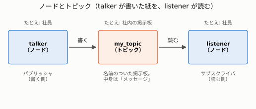
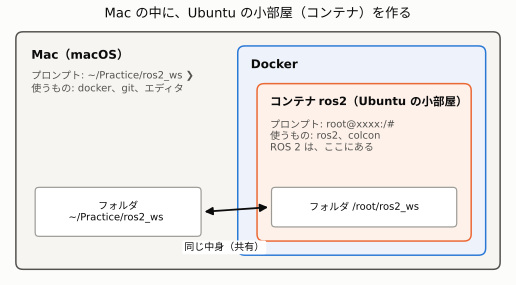

# 01. ROS 2 の基本 ― ノードとトピック

> **この章でわかること**
>
> - ROS 2 が、ロボットのプログラムを、どう分けて作るのか
> - 「ノード」「トピック」「メッセージ」「パラメータ」の意味
> - なぜ Docker を使うのか。Mac 側とコンテナの中の、見分けかた

## 1. ROS 2 とは

ロボットのプログラムを、1 つの大きなプログラムで作ると、作るのも直すのも大変です。
そこで ROS 2（ロス・ツー）では、**小さなプログラムに分けて、おたがいにメッセージを送り合う**形で作ります。

会社にたとえると、次のようになります。

| たとえ | ROS 2 での名前 | 意味 |
|---|---|---|
| 社員 | **ノード** | 1 つの仕事だけをする、小さなプログラム |
| 社内の掲示板 | **トピック** | メッセージを貼る場所。名前がついている |
| 掲示板に貼る人 | **パブリッシャ** | トピックに、メッセージを送る側 |
| 掲示板を読む人 | **サブスクライバ** | トピックから、メッセージを受け取る側 |
| 貼る紙の中身 | **メッセージ** | 数字や文字など。形（型）が決まっている |

社員（ノード）は、相手がだれかを知りません。**掲示板の名前さえ合っていれば、連絡できます。**
だから、片方だけを作り直したり、あとから 1 人増やしたりできます。

## 2. いちばん小さい例：talker と listener



| ノード | すること | コード |
|---|---|---|
| talker | `my_topic` に、1 秒ごとに文字を書く | [talker.py](../../src/my_first_pkg/my_first_pkg/talker.py) |
| listener | `my_topic` に文字が届いたら、画面に出す | [listener.py](../../src/my_first_pkg/my_first_pkg/listener.py) |

これだけでは地味ですが、**中身を入れかえると、ロボットになります**。

| この例 | 本物のロボット |
|---|---|
| talker（文字を書く） | センサーが、壁までの距離を書く |
| listener（読んで表示する） | 「壁が近いから止まろう」と決めるプログラム |

## 3. なぜ Docker を使うのか

ROS 2 は、Ubuntu（ウブントゥ。Linux の一種）で動かすように作られています。Mac には、そのままでは入りません。
そこで **Docker**（ドッカー）を使って、Mac の中に **Ubuntu の小部屋（コンテナ）**を作り、その中で ROS 2 を動かします。



いちばん大事なのは、**いま自分が「Mac 側」と「小部屋の中」の、どちらにいるか**を見分けることです。
ターミナルの行の始まり（プロンプト）で分かります。

| プロンプトの見た目 | いる場所 | 使えるコマンド |
|---|---|---|
| `~/Practice/ros2_ws ❯` | Mac 側 | `docker`、`git` |
| `root@xxxx:/#` | コンテナの中 | `ros2`、`colcon` |

まちがった側で打つと、`ros2: command not found`（そんなコマンドはない）のようなエラーが出ます。

**フォルダは、両方から見えます。** Mac の `~/Practice/ros2_ws` と、コンテナの `/root/ros2_ws` は、同じ中身です。Mac でファイルを保存すると、すぐコンテナからも見えます。

## 4. パラメータとは

**パラメータ**は、ノードの**設定**です。動いている最中に、外から変えられます。

たとえば、頭のノード `brain` には、「壁から何 m で止まるか」という設定 `turn_distance` があります。

```python
self.declare_parameter('turn_distance', 3.0)      # ① 名前と、はじめの値を決める
value = self.get_parameter('turn_distance').value  # ② 使うたびに、読み直す
```

```bash
ros2 param set /brain turn_distance 10.0   # 動いている brain の設定を、10.0 に変える
```

### いつ変わるのか

| 変えかた | いつ効くか | 起動し直したら |
|---|---|---|
| コードの「はじめの値」を書きかえる | 保存して、起動し直したとき | その値 |
| 起動するときに指定する（`--ros-args -p turn_distance:=5.0`） | 起動した瞬間 | 指定しなければ、はじめの値 |
| `ros2 param set` | **動いている最中に、すぐ** | はじめの値に戻る |

**動いている最中に変えても効くのは、②の「読み直す」が、メッセージが届くたびに動く場所にあるから**です。
起動のときに 1 回だけ読む場所（`__init__`）に書くと、あとから変えても、効きません。

## まとめ

| 覚えること | 内容 |
|---|---|
| ノード | 1 つの仕事だけをする、小さなプログラム |
| トピック | 名前のついた掲示板。名前が合えば、相手を知らなくても連絡できる |
| Docker | Mac の中に Ubuntu の小部屋を作る。ROS 2 は小部屋の中にある |
| プロンプト | `❯` なら Mac 側、`root@...:/#` ならコンテナの中 |
| パラメータ | 動いている最中に変えられる設定。使うたびに読み直す |

## 用語集

| 用語 | 読み | 意味 |
|---|---|---|
| ROS 2 | ロス・ツー | ロボットのプログラムを、部品に分けて作るための仕組み |
| ノード | | ROS 2 で動く、1 つのプログラム |
| トピック | | ノードどうしの掲示板。名前で区別する |
| パブリッシャ | | トピックに書く側 |
| サブスクライバ | | トピックを読む側 |
| メッセージ | | トピックに流れるデータ。`Float32`（数字）や `String`（文字）など |
| パラメータ | | ノードの設定。動いている最中に変えられる |
| パッケージ | | ノードのコードをまとめた「箱」 |
| colcon | コルコン | コードを、動かせる形にする（ビルドする）道具 |
| コンテナ | | Docker で作る、Ubuntu の小部屋 |
| プロンプト | | ターミナルの行の始まりに出る、記号や文字 |

次は [02. 壁に向かって走るロボット](02-robot-exercise.md) へ。
