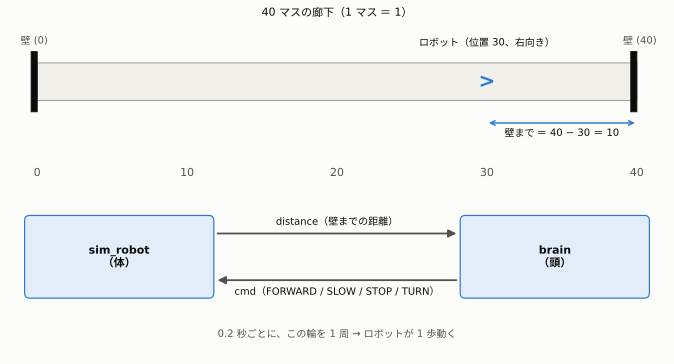
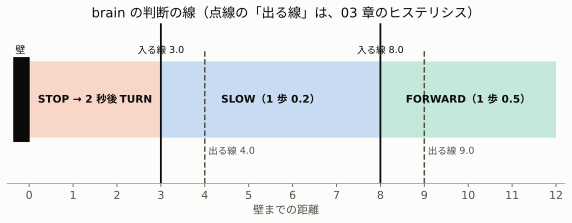
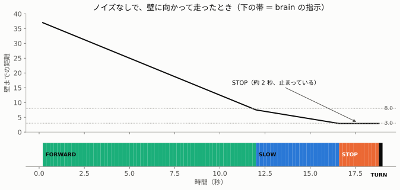

# 02. 壁に向かって走るロボットを、頭のノードで止める

> **この章でわかること**
>
> - 「センサー → 判断 → 動作」の流れを、2 つのノードで作る方法
> - 頭のノード `brain` の、4 つの指示と、判断の線
> - 「時刻を覚える変数」で、2 秒を数える方法

本物のロボットは使いません。ターミナルの文字で、ロボットの動きを見ます。

## 1. 登場するもの



| ノード | たとえ | すること | コード |
|---|---|---|---|
| `sim_robot` | 体 | 40 マスの廊下を走る。壁までの距離を知らせ、指示どおりに動く | [sim_robot.py](../../src/my_first_pkg/my_first_pkg/sim_robot.py) |
| `brain` | 頭 | 壁までの距離を見て、どう動くかを決める | [brain.py](../../src/my_first_pkg/my_first_pkg/brain.py) |

| トピック | 向き | 中身 |
|---|---|---|
| `distance` | 体 → 頭 | 壁までの距離（数字） |
| `cmd` | 頭 → 体 | 指示（`FORWARD`・`SLOW`・`STOP`・`TURN` のどれか） |

2 本の掲示板（トピック）で、**輪**になっています。**0.2 秒ごとに輪を 1 周して、ロボットが 1 歩動きます。**

| 順 | すること |
|---|---|
| 1 | 体が、いまの壁までの距離を `distance` に書く |
| 2 | 頭が、それを読んで、指示を `cmd` に書く |
| 3 | 体が、指示を読んで、1 歩動く |
| 4 | 1 にもどる |

**壁までの距離の計算**：右向きなら「40 − いまの位置」、左向きなら「いまの位置」です。
例：位置 30 で右向きなら、40 − 30 ＝ 10。

## 2. brain の 4 つの指示

| 壁までの距離 | 指示 | 体の動き（1 歩＝0.2 秒） |
|---|---|---|
| 8.0 以上 | `FORWARD` | 0.5 進む |
| 3.0 以上、8.0 より小さい | `SLOW` | 0.2 進む（ゆっくり） |
| 3.0 より小さくなってから 2 秒間 | `STOP` | 止まる |
| 3.0 より小さくなってから 2 秒たった | `TURN` | 向きを反対にする |



「3.0」と「8.0」は、パラメータ（`turn_distance`、`slow_distance`）なので、動いている最中に変えられます。
図の点線（4.0 と 9.0）は、判断がゆれるのを防ぐ「出る線」です。くわしくは [03](03-noise-and-filters.md) で説明します。

### 壁に向かって走ると

ノイズ（測るたびのぶれ）がないときの、1 回の走りです。



| 時間（だいたい） | 指示 | 壁までの距離 |
|---|---|---|
| 0〜12.0 秒 | `FORWARD` | 37.5 → 7.5 |
| 12.0〜16.6 秒 | `SLOW` | 7.5 → 2.9 |
| 16.6〜18.6 秒 | `STOP`（約 2 秒） | 2.9 のまま |
| 18.8 秒 | `TURN` | 向きが反対になり、廊下を引き返す |

## 3. 動かしかた

[README](../../README.md#実行方法) の手順でコンテナに入り、ターミナルのタブを 2 つ使います。

```bash
# タブ 1：体
ros2 run my_first_pkg sim_robot
# タブ 2：頭
ros2 run my_first_pkg brain
```

終わったら、両方で Ctrl+C を押します。止め忘れると、次に動かしたときに、まざります。

## 4. 実験

| 実験 | やること | 起きること |
|---|---|---|
| ① 頭なし | `sim_robot` だけを動かす | はじめの指示が `FORWARD` なので、壁まで進んで、ぶつかったまま止まる |
| ② 頭あり | `brain` も動かす | 壁の手前で `SLOW` → `STOP`（約 2 秒）→ `TURN`。廊下を行ったり来たりする |
| ③ 頭の性格を変える | `ros2 param set /brain turn_distance 10.0` | 壁のずっと手前で止まる（慎重な性格）。`1.0` にすると、ぎりぎりまで近づく |
| ④ やりとりをのぞく | `ros2 topic echo /cmd` | 頭が出している指示が、そのまま見える |
| ⑤ 人間が頭になる | `brain` を止めて、`ros2 topic pub /cmd std_msgs/msg/String "{data: TURN}" --once` | 人間の指示で、向きが変わる |
| ⑥ 頭がこわれたら | `brain` だけを Ctrl+C で止める | 体は、**最後の指示のまま**走り続ける |

③の `turn_distance` は、`slow_distance`（8.0）より小さい値にしてください。

**②で分かること**：2 つのノードは、おたがいを知りません。`distance` と `cmd` という**名前だけ**で、つながっています。

**⑥で分かること**：本物のロボットでは、頭が止まったときに、体を止める仕組み（安全装置）が大切です。ステップ 2 の `room_sim` には、「指示が 0.5 秒来なければ止まる」安全装置を入れました。

## 5. STOP の 2 秒を数える仕組み

`brain` は、**「いつから STOP を始めたか」を覚えて**います。時刻を覚える変数 `self.stop_started` を使います。

```python
if self.stop_started is None:        # ① まだ覚えていない ＝ 初めて近づいた
    self.stop_started = now          #    いまの時刻を覚える
if now - self.stop_started > 2.0:    # ② 覚えた時刻から、2 秒たったか？
    cmd = 'TURN'
else:
    cmd = 'STOP'
```

**例**：時計が 16.6 秒のときに、初めて近づいたとき（上の走りと同じ）

| いまの時刻（秒） | 覚えた時刻 | 差 | 指示 |
|---|---|---|---|
| 16.6 | 16.6（ここで覚える） | 0.0 | `STOP` |
| 17.6 | 16.6 | 1.0 | `STOP` |
| 18.6 | 16.6 | 2.0 | `STOP`（2.0 は「2 より大きい」ではない） |
| 18.8 | 16.6 | 2.2 | **`TURN`** |

壁から離れたら、覚えた時刻を**忘れます**（`self.stop_started = None`）。
忘れないと、反対側の壁に着いたとき、「もう 2 秒たっている」とまちがえて、**STOP をせずに、いきなり TURN** してしまいます。

> **覚えること**：`__init__` で作った変数は、メッセージが届くたびに、前の値を覚えている。「状態を持つノード」の基本です。

## まとめ

| 覚えること | 内容 |
|---|---|
| 輪 | 体 → `distance` → 頭 → `cmd` → 体。0.2 秒で 1 周 |
| 4 つの指示 | 8.0 以上で FORWARD、3.0〜8.0 で SLOW、3.0 より近いと STOP（2 秒）→ TURN |
| つながり | ノードは、トピックの名前だけでつながる |
| 時刻を覚える | 初めて近づいた時刻を覚え、差が 2 秒を超えたら TURN。離れたら忘れる |

## 本物のロボットとの対応

| この演習 | 本物（ステップ 2 で使う形） |
|---|---|
| `distance`（数字 1 つ） | `/scan`（レーザーセンサーの、360 個の距離） |
| `cmd`（言葉） | `/cmd_vel`（進む速さと回る速さ） |
| `brain` | 障害物をよけるプログラム |
| `sim_robot` | モーターとタイヤ |

次は [03. ノイズ・チャタリング・フィルタ](03-noise-and-filters.md) へ。
