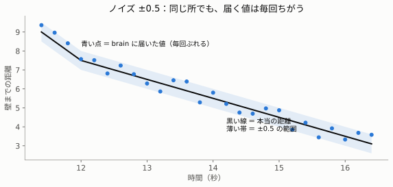
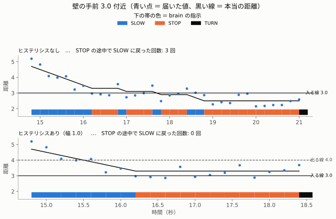
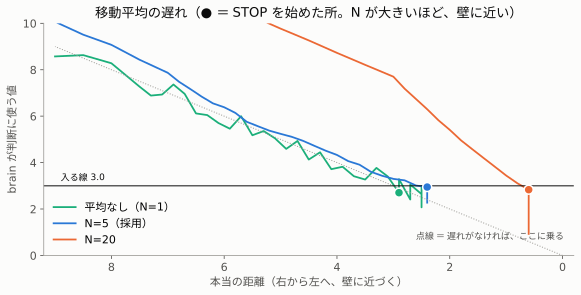
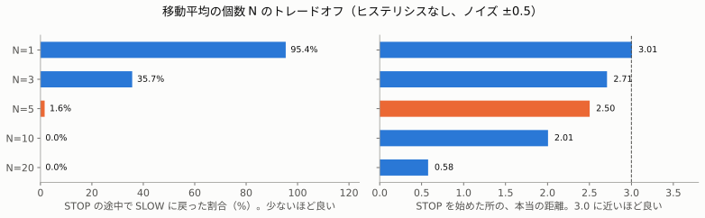
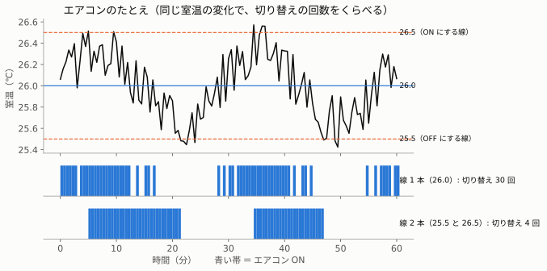
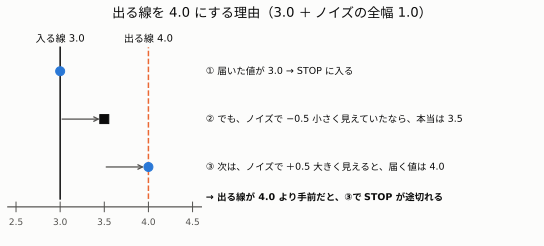
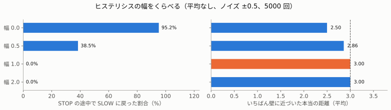

# 03. センサーのノイズ・チャタリング・フィルタ

> **この章でわかること**
>
> - ノイズ（測るたびのぶれ）が、ロボットの判断を「ゆらす」しくみ
> - 対策 ① 移動平均：ぶれを小さくする。ただし、反応が遅れる
> - 対策 ② ヒステリシス：「入る線」と「出る線」をずらして、判断のゆれを止める

## 1. ノイズとは

本物のセンサーは、同じ所を測っても、**毎回少しずつちがう値**を返します。この「ぶれ」を**ノイズ**と呼びます。

`sim_robot` は、`brain` に送る距離に、**−0.5〜+0.5 のぶれ**を足しています。



| 本当の距離 | `brain` に届く値の例 |
|---|---|
| 3.0 | 2.7、3.4、2.9、3.1、2.6、3.3 … （2.5〜3.5 の間で、ばらばら） |

ぶれるのは、**`brain` に届く値だけ**です。ロボットの本当の位置は、ぶれません。本物のセンサーも同じです。

> **ノイズの全幅**：±0.5 なら、ぶれる範囲の全体は 1.0（−0.5 から +0.5 まで）。この章では「全幅」と呼びます。

## 2. チャタリング：判断が、行ったり来たりする

**チャタリング**とは、値が**判断の線のそば**でぶれて、**判断が短い間に行ったり来たりする**ことです。
もとは、スイッチが「カチカチカチ」と細かく入ったり切れたりすることを指す言葉です。

`brain` は、3.0 より小さいと `STOP` します。本当の距離が 2.9 のとき、ノイズでこうなります。

| 届いた値 | `brain` の判断 |
|---|---|
| 2.8 | `STOP`（3.0 より小さい） |
| 3.2 | `SLOW`（3.0 以上）← 本当は、止まっているべき |
| 2.7 | `STOP` |

下の図の上の段が、ヒステリシス（4 章）なしの例です。下の帯で、オレンジ（STOP）の間に、青（SLOW）が何度もまざっています。



### なぜ困るのか

| 困ること | 理由 |
|---|---|
| ① STOP の 2 秒を、数え直してしまう | SLOW がまざると、「壁から離れた」と判断して、覚えた時刻を忘れる（[02 の 5 章](02-robot-exercise.md#5-stop-の-2-秒を数える仕組み)）。STOP が 4 秒以上続くこともある |
| ② 壁に近づいていく | SLOW のたびに、0.2 ずつ前に進む |

| | いちばん壁に近づいた所（5000 回の平均） |
|---|---|
| 対策なし | **2.50**（3.0 で止まるはずが、0.5 も近づく） |
| ヒステリシスあり（4 章） | **3.00** |

---

## 3. 対策 1：移動平均

**直近 N 回ぶんの値を平均して**、判断に使います。`brain.py` では N ＝ 5 です。
ノイズは、プラスにもマイナスにも出るので、平均すると、打ち消し合います。

**例**：本当の距離が 3.0 のとき、届いた 5 回ぶん

```
(2.7 ＋ 3.4 ＋ 2.9 ＋ 3.1 ＋ 2.6) ÷ 5 ＝ 14.7 ÷ 5 ＝ 2.94
```

1 回ずつ見ると 2.6〜3.4 とばらばらでしたが、平均は 2.94 で、本当の値（3.0）に近くなりました。

```python
self.history = deque(maxlen=5)                 # 5 個まで覚える入れ物（6 個目で、いちばん古いのを捨てる）
self.history.append(msg.data)                  # 新しい値を入れる
dist = sum(self.history) / len(self.history)   # 覚えている分の平均
```

### 弱点：反応が遅れる

平均には、**過去の値**がまざります。壁に近づいている間、過去の値は「いまより遠い」値です。
だから平均は、本当の距離より**遠く**に見えて、**止まるのが遅れます**（危ない向き）。



図の ● が、STOP を始めた所です。N ＝ 20 は、壁まで 0.6 くらいになって、やっと止まりはじめています。

### N をいくつにするか



| N | STOP の途中で SLOW に戻った割合 | STOP を始めた所（本当の距離） | いちばん近づいた所 |
|---|---|---|---|
| 1（平均しない） | 95.4% | 3.01 | 2.50 |
| 3 | 35.7% | 2.71 | 2.59 |
| **5（採用）** | **1.6%** | **2.50** | **2.49** |
| 10 | 0.0% | 2.01 | 2.00 |
| 20 | 0.0% | **0.58** | **0.58** |

ヒステリシスなし、ノイズ ±0.5、5000 回（STOP を始めた所は 2000 回）の平均です。
実際に動かしたときも、N ＝ 20 では、壁まで 0.4 で STOP が始まり、ほぼぶつかりました。

> **覚えること**：N を大きくすると、ぶれは減る。でも、反応が遅れて危なくなる。ちょうどよい N は、ロボットの速さと、安全に止まりたい距離で決める。

---

## 4. 対策 2：ヒステリシス

**ヒステリシス**とは、切り替えの線を、**「入るとき」と「出るとき」で、わざとずらす**しくみです。

### たとえ：エアコン



同じ室温の変化でも、線の引きかたで、切り替えの回数が大きく変わります。

| 線の引きかた | 動き | 切り替え（図の 60 分） |
|---|---|---|
| 線 1 本（26.0℃） | 26.0 を超えたら ON、下回ったら OFF | **30 回**（ON・OFF をくり返す） |
| 線 2 本（26.5℃ と 25.5℃） | 26.5 を超えたら ON。**25.5 を下回るまで OFF にしない** | **4 回** |

### この演習での 2 本の線

| 線 | 値 | 役わり |
|---|---|---|
| 入る線 | `turn_distance`（3.0） | STOP を**始める**距離。止まる場所は、これで決まる |
| 出る線 | `turn_distance ＋ hysteresis`（4.0） | STOP を**やめる**距離。STOP 中だけ使う |

3.0〜4.0 の間では、**いまの状態を続けます**。STOP 中に、ノイズで 3.2 や 3.5 に見えても、STOP は途切れません。
[02 の図](02-robot-exercise.md#2-brain-の-4-つの指示)の点線が、出る線です。

```python
threshold = turn + hysteresis if self.stop_started is not None else turn
if dist < threshold:
    ...   # STOP か TURN
```

| `self.stop_started` | 意味 | 使う線 |
|---|---|---|
| `None` ではない（時刻が入っている） | いま STOP 中 | 出る線 4.0 |
| `None` | まだ STOP していない | 入る線 3.0 |

### 幅（入る線と出る線の差）は、どう決めるか

**幅は、ノイズの全幅（1.0）以上にします。** つまり、出る線は 3.0 ＋ 1.0 ＝ 4.0 です。



| 順 | 起きうること |
|---|---|
| ① | 届いた値が 3.0 で、STOP に入る |
| ② | でも、ノイズで −0.5 小さく見えていたなら、本当の距離は 3.5 |
| ③ | 次の測定で、ノイズが +0.5 なら、届く値は 4.0 |

出る線が 4.0 より手前（たとえば 3.5）だと、③で「出た」と判断して、STOP が途切れてしまいます。



| 幅 `hysteresis` | STOP の途中で SLOW に戻った割合 | いちばん近づいた所 |
|---|---|---|
| 0（なし） | 95.2% | 2.50 |
| 0.5 | 38.5% | 2.86 |
| **1.0（採用）** | **0.0%** | **3.00** |
| 2.0 | 0.0% | 3.00 |

平均なし（N ＝ 1）、ノイズ ±0.5、5000 回の平均です。0.5 では足りず、1.0（ノイズの全幅）で 0% になりました。

### 何が変わって、何が変わらないか

| | ヒステリシスなし | あり（幅 1.0） |
|---|---|---|
| STOP を**始める**距離 | 約 3.0 | 約 3.0（**同じ**） |
| いちばん近づいた所 | 2.50 | **3.00** |
| STOP の途中の SLOW | まざる | まざらない |

始める距離は変わりません。でも、SLOW がまざらなくなるので、壁に近づきすぎなくなります。

### 線は、境目ごとに入れる

ヒステリシスは、**入れた境目のゆれしか、止められません。** `brain` には、境目が 2 つあります。

| 境目 | 切り替わる指示 | 入る線 | 出る線 |
|---|---|---|---|
| ① STOP の境目 | `SLOW` ↔ `STOP` | 3.0 | 4.0 |
| ② SLOW の境目 | `FORWARD` ↔ `SLOW` | 8.0 | 9.0 |

最初は、①にだけ入れていました。すると、②で、ゆれが残りました。

```
壁まで= 8.1  指示=SLOW
壁まで= 7.6  指示=FORWARD    ← 8.0 のそばで、FORWARD にもどる
壁まで= 7.4  指示=SLOW
```

| 設定（平均なし、幅 1.0） | 8.0 のそばで、SLOW から FORWARD にもどった割合 |
|---|---|
| ②に入れない | **18.8%**（壁 5 回に 1 回くらい） |
| ②にも入れる（いまの `brain`） | **0.0%** |

#### ②の書きかた

①と同じ形です。ちがうのは、「いま、その状態か」を知る方法です。

| | 「いま、その状態か」の目印 | 理由 |
|---|---|---|
| ① STOP | `self.stop_started is not None` | STOP は、始めた時刻を覚えている。時刻が入っていれば STOP 中 |
| ② SLOW | `self.slowing`（`True` か `False`） | SLOW には、覚える時刻がない。だから、専用の目印を作る |

```python
self.slowing = False   # __init__ で 1 回だけ作る

slow_threshold = slow + hysteresis if self.slowing else slow
...
elif dist < slow_threshold:
    self.slowing = True      # SLOW に入ったら True
    cmd = 'SLOW'
else:
    self.slowing = False     # FORWARD にもどったら False
    cmd = 'FORWARD'
```

#### よくある書きまちがい

| 書きかた | 起きること |
|---|---|
| `x = (条件) ? a : b` | 動かない（`SyntaxError`）。`? :` は、Python にない書きかた。正しくは `a if 条件 else b` |
| `self.slowing = False` を、`on_distance` の先頭に書く | 毎回 `False` にもどり、覚えていられない |
| `if self.slowing is not None` | `True` も `False` も `None` ではないので、いつも「SLOW 中」になる。`is not None` は、`None` かどうかで状態を表す変数（`stop_started`）にだけ使う |

#### 本物の brain で確かめる

`sim_robot` を使わずに、本物の `brain` へ、距離を直接送るテストがあります。
本当の距離を 8.0〜9.0 の間（8.3）に置き、ノイズ ±1.0 をのせて、300 回送ります。

```bash
python3 tools/probe_brain_slow_band.py     # コンテナの中で（source 済み）
```

| `hysteresis` | SLOW と FORWARD が入れかわった回数（300 回中） |
|---|---|
| 0.0 | 31 回（乱数で変わる。数十回） |
| 1.0 | **0 回**（ずっと `SLOW`） |

> このテストは、ほかの `brain` とまざらないよう、別の `ROS_DOMAIN_ID` を使います。最初に、まざったまま動かしたときは、`hysteresis=1.0` でも 21 回と出ました。

---

## 5. どう使い分けるか

| | 移動平均 | ヒステリシス |
|---|---|---|
| 減らすもの | 値そのもののぶれ | 判断の入れかわり |
| 弱点 | 反応が遅れ、壁に近づく | 値のぶれは、減らない |
| 向いている所 | 値をなめらかにしたいとき | 状態を切り替える判断 |

本物のロボットでは、**両方を組み合わせる**のがふつうです。この演習では、平均 N ＝ 5、ヒステリシスの幅 1.0 にしました。

### ノイズが大きいとき

| ノイズ | ヒステリシスだけ（幅 1.0） | 平均だけ（N ＝ 5） |
|---|---|---|
| ±0.2 | 0.0% | 0.0% |
| ±0.5 | 0.0% | 1.7% |
| ±1.0 | **63.1%** | 27.0% |

数字は「STOP の途中で SLOW に戻った割合」（5000 回）。ノイズが ±1.0（全幅 2.0）になると、幅 1.0 では足りません。**幅は、ノイズの全幅に合わせて広げます。**

## 6. 実験：ヒステリシスの効き目を、自分の目で見る

`hysteresis` はパラメータなので、動かしたまま切り替えられます。

まず、効き目を見やすくするため、`brain.py` の `deque(maxlen=5)` を、一時的に `maxlen=1`（平均しない）にして、`brain` を起動し直します。

```bash
ros2 param set /brain hysteresis 0.0   # ゆれが出る
ros2 param set /brain hysteresis 1.0   # ゆれが消える
```

| 見る所 | ゆれかた | 幅 0.0 のとき | 幅 1.0 のとき |
|---|---|---|---|
| 壁まで 3.0 のそば | `STOP` の途中に `SLOW` がまざる | ほぼ毎回 | 出ない |
| 壁まで 8.0 のそば | `SLOW` のあとに `FORWARD` がまざる | 壁 5 回に 1 回くらい | 出ない |

8.0 のそばのゆれは、たまにしか出ません。**1 回の壁で出なくても、「直った」とは言えません。** 何周か見るか、上のテストで、数百回まとめて確かめます。
確かめ終わったら、`maxlen=5` にもどしてください。

## 7. 数字を、自分で確かめる

| スクリプト | 動かす場所 | 確かめること |
|---|---|---|
| [tools/simulate_filters.py](../../tools/simulate_filters.py) | Mac（ROS 2 なし） | この章の表の数字。`brain.py` と同じ判断を、何千回もくり返す |
| [tools/make_basics_figures.py](../../tools/make_basics_figures.py) | Mac（ROS 2 なし） | この章の図。上のスクリプトと同じ計算から作る |
| [tools/probe_brain_slow_band.py](../../tools/probe_brain_slow_band.py) | コンテナの中 | **本物の** `brain` が、出る線 9.0 で、ゆれを止めるか |

```bash
python3 tools/simulate_filters.py          # Mac で
python3 tools/make_basics_figures.py       # Mac で（matplotlib が必要）
python3 tools/probe_brain_slow_band.py     # コンテナの中で
```

**まねした計算が合っていても、本物のコードに書きまちがいがあれば、動きません。** 両方で確かめると、安心です。

## まとめ

| 覚えること | 内容 |
|---|---|
| ノイズ | 測るたびの、ばらばらなぶれ。全幅 ＝ ぶれる範囲の全体 |
| チャタリング | 線のそばで、判断が行ったり来たりすること |
| 移動平均 | ぶれを減らす。N が大きいほど、反応が遅れる |
| ヒステリシス | 入る線と出る線をずらして、ゆれを止める。幅は、ノイズの全幅以上 |
| 境目ごと | ヒステリシスは、入れた境目にしか効かない |

## 用語集

| 用語 | 意味 |
|---|---|
| ノイズ | 測るたびに、値がばらばらにぶれること |
| 全幅 | ぶれる範囲の、いちばん上といちばん下の差（±0.5 なら 1.0） |
| チャタリング | 線のそばで、判断が短い間に入れかわること |
| 移動平均 | 直近 N 回ぶんの平均 |
| ヒステリシス | 入る線と出る線を、わざとずらすしくみ |
| 遅れ | 本当の変化が、判断にあらわれるまでの時間 |
| トレードオフ | 片方を良くすると、もう片方が悪くなる関係 |

困ったときは [04. つまずきやすい点と対処](04-troubleshooting.md) へ。
