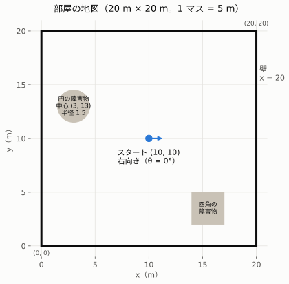
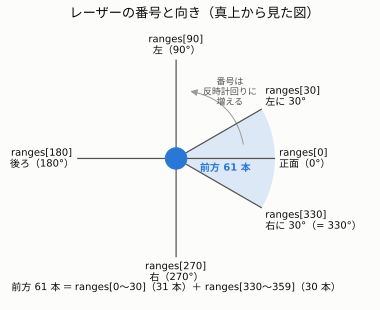
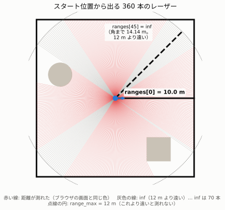
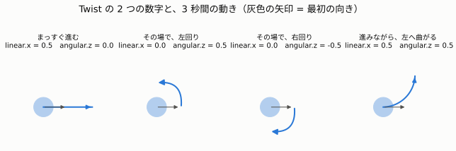
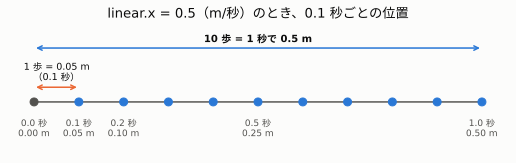

# 01. 部屋を走る掃除ロボット ― 目的と、2 つのメッセージ

> **この章でわかること**
>
> - ステップ 2 で、何を作るのか。なぜ作るのか
> - ロボットの「目」から届くデータ `/scan` の読みかた
> - ロボットの「足」に出す指示 `/cmd_vel` の書きかた

## 1. 何を作るのか

**部屋の中を、壁や家具にぶつからずに走り続けるロボット**を作ります。ロボット掃除機と同じ仕事です。

ロボットは、3 つの部分に分かれています。

| 部分 | 人間でいうと | この演習では |
|---|---|---|
| センサー（LiDAR） | 目 | まわりの壁までの距離を測る → `/scan` |
| 判断するプログラム | 頭 | 「前が近いから曲がろう」と決める → `avoider`（あなたが書く） |
| モーターとタイヤ | 足 | 言われた速さで動く ← `/cmd_vel` |

今回は、実物のロボットの代わりに、**`room_sim`**（部屋とロボットのシミュレータ）を使います。目と足の役は、`room_sim` が受け持ちます。

```
room_sim（目と足）──── /scan：まわりの距離 ────→ avoider（頭）
       ↑                                              │
       └──────── /cmd_vel：進む速さ・回る速さ ←────────┘
```

### 入門編との違い

入門編のロボットは、名前も中身も、自分で決めた「練習用」でした。
ステップ 2 は、**本物のロボットと同じ形のデータ**を使います。

| | 入門編 | ステップ 2 |
|---|---|---|
| 目から届くもの | `distance`：数字 1 つ | `/scan`：**数字 360 個** |
| 足への指示 | `cmd`：`FORWARD` などの言葉 | `/cmd_vel`：**速さの数字 2 つ** |
| 世界 | 1 本の廊下 | 障害物のある部屋 |

形が本物と同じなので、あなたが書く `avoider` は、**本物のロボットにも、ほぼそのまま載せられます**。
これが ROS 2 の強みです。部品（ノード）を、差し替えられるからです。

## 2. 部屋の地図



| もの | 場所 |
|---|---|
| 部屋 | 横 20 m × たて 20 m。左下が (0, 0)、右上が (20, 20) |
| ロボット | スタートは真ん中の (10, 10)。右を向いている |
| 円の障害物 | 中心 (3, 13)、半径 1.5 m |
| 四角の障害物 | x が 14〜17、y が 2〜5 |

位置は、数学のグラフと同じく (x, y) で表します。**右へ行くと x が増え、上へ行くと y が増えます。**

## 3. `/scan`：目から届く 360 個の距離

### 3.1 LiDAR とは

LiDAR（ライダー）は、**レーザーの光を出して、はね返るまでの時間で、距離を測るセンサー**です。
ぐるっと 1 周、まわりの距離を測ります。

この演習では、**1° ごとに 1 本、合計 360 本**のレーザーを出します。円 1 周が 360° だからです。
（365 ではありません。365 は 1 年の日数です。）

### 3.2 番号と向き

測った距離は、**`ranges`** という名前の、360 個の数字の並び（配列）に入ります。
**番号が、そのまま角度（度）**です。



| 番号 | 向き |
|---|---|
| `ranges[0]` | 正面 |
| `ranges[90]` | 左 |
| `ranges[180]` | 真後ろ |
| `ranges[270]` | 右 |

番号は、**真上から見て、反時計回りに増えます**。
右側は 270° 前後なので、「右に 30°」は `ranges[330]`（360 − 30）になります。

### 3.3 例：スタート位置で測ると



| 番号 | 値 | 計算 |
|---|---|---|
| `ranges[0]`（正面） | **10.0 m** | 右の壁 x = 20 まで、20 − 10 = 10 m |
| `ranges[90]`（左） | **10.0 m** | 上の壁 y = 20 まで、20 − 10 = 10 m |
| `ranges[45]`（左ななめ前） | **inf** | 右上の角まで、約 14.14 m。12 m より遠いので「測れない」 |

`ranges[45]` の 14.14 m は、三平方の定理（中学 3 年）で計算できます。

```
右に 10 m、上に 10 m 進んだ所が、右上の角 (20, 20)
ななめの長さ ＝ √(10 × 10 ＋ 10 × 10) ＝ √200 ≒ 14.14 m
```

### 3.4 `inf`（測れなかった）

このロボットの LiDAR は、**12 m より遠い物は、測れません**。測れなかったレーザーには、**`inf`**（インフ。「無限大」の意味）が入ります。

| 場面 | 値 |
|---|---|
| 12 m 以内に壁がある | その距離（例：10.0） |
| 12 m 以内に何もない | `inf` |

スタート位置では、360 本のうち **70 本が `inf`** でした（上の図の灰色の線）。部屋の四すみの方向は、壁まで 12 m を超えるからです。

### 3.5 `/scan` の中身（主なもの）

| 名前 | 意味 | この演習の値 |
|---|---|---|
| `ranges` | 360 個の距離（m） | 例：`ranges[0]` = 10.0 |
| `angle_increment` | レーザーとレーザーの間の角度 | 1°（中身は 0.01745。単位がラジアンのため。下の 4.3 を参照） |
| `range_max` | 測れる、いちばん遠い距離 | 12.0 m |
| `range_min` | 測れる、いちばん近い距離 | 0.1 m |

> 本数は、LiDAR の機種で変わります（0.5° ごとなら 720 本）。プログラムでは、「360」と決めつけないほうが安全です。

## 4. `/cmd_vel`：足に出す指示

### 4.1 指示は、2 つの数字

入門編では `FORWARD` のような**言葉**で指示しました。本物のロボットは、**速さの数字**で指示します。

| 名前 | 意味 | 単位 | 車でいうと |
|---|---|---|---|
| `linear.x` | 前に進む速さ | m/秒 | アクセル |
| `angular.z` | その場で回る速さ | rad/秒 | ハンドル |

この 2 つを入れる入れ物を、**`Twist`**（ツイスト）と呼びます。



| `linear.x` | `angular.z` | 動き |
|---|---|---|
| 0.5 | 0 | まっすぐ進む |
| 0 | 0.5 | その場で、左回り（反時計回り） |
| 0 | −0.5 | その場で、右回り（時計回り） |
| 0.5 | 0.5 | 進みながら、左へ曲がる |

### 4.2 `0.5` は「1 回に進む距離」ではなく「速さ」

**`linear.x = 0.5` は、「1 秒で 0.5 m 進む速さ」**という意味です。
`room_sim` は、0.1 秒ごとにロボットを少しずつ動かします。



```
1 歩（0.1 秒）で進む距離 ＝ 速さ × 時間 ＝ 0.5 × 0.1 ＝ 0.05 m
10 歩（1 秒）で進む距離  ＝ 0.05 × 10   ＝ 0.5 m
```

たとえば、時速 60 km の車は、1 時間で 60 km 進みます。でも、1 分では 1 km しか進みません。それと同じです。

### 4.3 回る速さの単位「rad（ラジアン）」

角度には、「度（°）」のほかに、**rad（ラジアン）**という単位があります。ロボットの世界では、ラジアンをよく使います。
くわしくは高校で習います。ここでは、次の表だけ覚えれば十分です。

| ラジアン | 度 |
|---|---|
| 1 rad | 約 57° |
| 3.14 rad（π） | 180°（半周） |
| **6.28 rad（2π）** | **360°（1 周）** |

**例：`angular.z = 0.5` で、1 周するのに何秒かかるか**

```
1 秒で回る角度 ＝ 0.5 rad ≒ 0.5 × 57° ≒ 29°
1 周にかかる時間 ＝ 6.28 ÷ 0.5 ＝ 12.56 秒
```

「速さ × 時間 ＝ 距離」と同じように、**「回る速さ × 時間 ＝ 回った角度」**です。

## 5. 本物のロボットとの対応

| この演習 | 本物 |
|---|---|
| `/scan` | 本物の LiDAR も、同じ名前・同じ形で出す |
| `/cmd_vel` | 本物のロボット（TurtleBot3 など）も、同じ名前・同じ形で受け取る |
| `room_sim` | モーター・タイヤ・LiDAR（機械の部分） |
| `avoider` | 障害物をよけるプログラム |

## 6. これからの進め方

| フェーズ | やること | 書く人 | 状況 |
|---|---|---|---|
| 0. 準備 | パッケージ `room_robot_pkg` を作る | Claude | ✅ |
| 1. 世界と表示 | `room_sim` を作り、手で動かして確かめる（[02](02-room-sim.md)、[03](03-experiments.md)） | Claude（動かすのはあなた） | ✅ |
| 2. よけるだけ | 前が近ければ回る `avoider`（[05](05-avoider.md)） | **あなた** | ✅ |
| 3. ノイズ対策 | 測った距離のぶれに強くする（[06](06-noise-and-filter.md)） | **あなた** | ✅ |
| 4. ヒステリシス | 回り始める線と、やめる線をずらす | **あなた** | 次 |
| 5. launch ファイル | 複数のノードを、1 つのコマンドで起動する | 一緒に | |

## まとめ

| 覚えること | 内容 |
|---|---|
| `/scan` | まわり 360 本の距離。`ranges[0]` が正面、番号は反時計回り |
| `inf` | 12 m より遠くて、測れなかった印 |
| `/cmd_vel` | 進む速さ（m/秒）と、回る速さ（rad/秒） |
| 速さ | 1 歩（0.1 秒）で進むのは、速さ × 0.1 |
| ラジアン | 1 周 ＝ 約 6.28 rad、1 rad ≒ 57° |

## 用語集

| 用語 | 読み | 意味 |
|---|---|---|
| LiDAR | ライダー | レーザーで、まわりの距離を測るセンサー |
| 配列 | はいれつ | 数字を、番号つきで並べたもの。`ranges[0]` は 0 番目 |
| `LaserScan` | レーザースキャン | `/scan` で届くデータの形の名前 |
| `Twist` | ツイスト | `/cmd_vel` で送る、速さ 2 つの入れ物 |
| `inf` | インフ | 無限大。ここでは「測れなかった」の印 |
| rad | ラジアン | 角度の単位。1 周 ＝ 約 6.28 rad |

次は [02. room_sim の仕組み](02-room-sim.md) へ。
