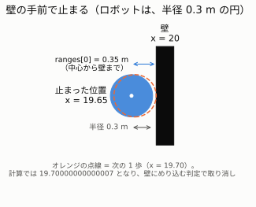

# 03. 実験の記録 ― 予想して、測って、くらべる

> **この章でわかること**
>
> - `room_sim` を手で動かした 3 つの実験の結果
> - 予想がはずれた理由（ロボットの大きさ、速さの意味、指示の届きかた）

どの実験も、**先に予想を書いてから、測りました**。予想がはずれた所に、いちばんの学びがありました。

| 実験 | 確かめたこと |
|---|---|
| 1. 正面とななめの距離 | `ranges` の番号と向き。`inf` |
| 2. 壁まで、まっすぐ進む | 速さの意味。ロボットの大きさ |
| 3. その場で回る | 回る速さと角度。指示の届きかた |

---

## 実験 1. 正面とななめの距離

**問題**：スタート位置 (10, 10)、右向きのとき、`ranges[0]`（正面）と `ranges[45]`（左ななめ前）は何 m か。

| | あなたの予想 | 結果 |
|---|---|---|
| `ranges[0]` | 10 m | **10.0 m** ✅ |
| `ranges[45]` | `ranges[0]` より大きい（√2 倍） | **`inf`**（本当は 14.14 m。12 m より遠いので「測れない」）✅ |


**なぜ**：右上の角 (20, 20) までは、右に 10 m・上に 10 m です。三平方の定理で、√(10² ＋ 10²) ≒ 14.14 m。予想どおり、正面の √2 倍（約 1.41 倍）です。
ただし、この LiDAR は 12 m までしか測れないので、値は `inf` になりました。

ほかの番号も、測って確かめました。

| 番号 | 向き | 値 | 何に当たったか |
|---|---|---|---|
| 0 | 正面（右） | 10.0 | 右の壁 |
| 90 | 左（上） | 10.0 | 上の壁 |
| 180 | 後ろ（左） | 10.0 | 左の壁 |
| 270 | 右（下） | 10.0 | 下の壁 |
| 45、135、225 | ななめ | `inf` | 角まで 14.14 m（12 m より遠い） |
| 315 | 右ななめ前 | 7.07 | 四角の障害物の角 (15, 5) |

> **覚えること**：`ranges` の番号 ＝ 角度。12 m より遠いと `inf`。

---

## 実験 2. 壁まで、まっすぐ進む

**問題**：x = 14.95 の所から、`linear.x = 0.5` を送り続ける。右の壁（x = 20）に着いて止まるまで、何秒か。止まったときの x はいくつか。

| | あなたの予想 | 結果 |
|---|---|---|
| 止まるまでの時間 | 11 秒 | **約 9.4 秒** |
| 止まった位置 | x = 20 | **x = 19.65** |
| そのときの `ranges[0]` | ― | **0.35 m** |



### なぜ x = 20 にならないのか：ロボットには大きさがある

ロボットは**半径 0.3 m の円**です。**円の端**が壁に触れたら、それ以上は進めません。

```
中心が行ける限界 ＝ 壁 − 半径 ＝ 20 − 0.3 ＝ 19.7
```

`x` は、ロボットの**中心**の位置です。だから、20 にはなりません。

### なぜ 19.7 ではなく 19.65 なのか：1 歩 0.05 m と、小数のごまかし

1 歩で進むのは、0.5 × 0.1 ＝ **0.05 m** です（[01 の 4.2](01-lidar-and-twist.md#42-05-は1-回に進む距離ではなく速さ)）。

| 歩数 | 計算上の x | 判定 |
|---|---|---|
| 0 | 14.95 | スタート |
| 94 歩 | 19.65 | 進める |
| 95 歩 | 19.70000000000007 | **19.7 をほんの少し超える → めり込み → 取り消し** |

コンピュータは、0.05 のような小数を、**ぴったりには覚えられません**。足し算をくり返すと、ほんの少しずつ、ずれがたまります。
そのため、95 歩目は「めり込む」と判定され、19.65 で止まりました。（同じ計算を Python で再現して、確かめました。）

> **覚えること**：コンピュータの小数は、ぴったりではない。「ちょうど 19.7 か」のような、ぎりぎりの比べかたは、しない。

### 時間の答え

```
進んだ距離 ＝ 19.65 − 14.95 ＝ 4.7 m
かかった時間 ＝ 距離 ÷ 速さ ＝ 4.7 ÷ 0.5 ＝ 9.4 秒
```

ターミナルの `publishing #143`（送った回数）は、**時間を測る目安にはなりません**。止まったあとも、Ctrl+C を押すまで、送り続けているからです。

> **覚えること**：`0.5` は速さ（m/秒）。1 歩（0.1 秒）では 0.05 m。

---

## 実験 3. その場で回る

**問題 1**：`linear.x = 0`、`angular.z = 0.5` で回ると、1 周に何秒かかるか。

| | あなたの予想 | 結果 |
|---|---|---|
| 1 周の時間 | **12.56 秒** | 計算どおり ✅（6.28 ÷ 0.5 ＝ 12.56） |

**問題 2**：6.28 秒だけ指示を送る（`timeout 6.28`）と、何度回るか。半周なので、180° のはず。

| | 計算 | 結果 |
|---|---|---|
| 回った角度 | 180° | **172°**（2 回やって、2 回とも 172°） |

### なぜ 172° なのか：指示が届いていた時間は 6.28 秒ではなかった

ログを調べると、指示は **56 回**しか送られていませんでした（1 秒に 10 回なら、63 回のはず）。

| 時間の流れ | 長さ |
|---|---|
| ① `ros2 topic pub` が起動して、準備する（この間は、送らない） | 約 0.7 秒 |
| ② 1 回目から 56 回目まで、0.1 秒ごとに送る | 5.5 秒 |
| ③ 指示が止まってから、ロボットが止まるまで（[02 の 4 章](02-room-sim.md#4-指示が止まったら止まる暴走防止)） | 0.5 秒 |

```
回っていた時間 ＝ ② ＋ ③ ＝ 5.5 ＋ 0.5 ＝ 6.0 秒
回った角度    ＝ 0.5 rad/秒 × 6.0 秒 ＝ 3.0 rad ≒ 3.0 × 57.3° ≒ 172°  ✅
```

①の「準備に約 0.7 秒」は、`room_sim` なしで `pub` だけを 2 回動かしても、同じく 56 回だったことで確かめました。

> **覚えること**：「指示を送った時間」と「ロボットが動いた時間」は、少しちがう。起動の準備と、止まるまでの 0.5 秒がある。

---

## まとめ：予想がはずれた 3 つの理由

| はずれた予想 | 本当は | 覚えること |
|---|---|---|
| x = 20 で止まる | x = 19.65 | ロボットの**中心**と**端**はちがう。半径 0.3 m |
| 0.5 m ずつ進む | 1 歩 0.05 m | 0.5 は**速さ**（m/秒） |
| 6.28 秒で、ちょうど 180° | 172° | 送った時間と、動いた時間はちがう |

次は [04. つまずきやすい点と対処](04-troubleshooting.md) へ。
