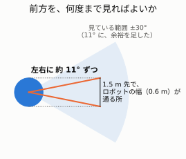
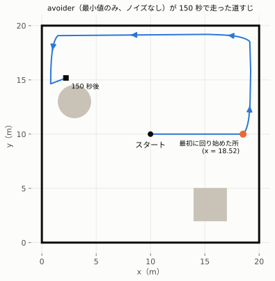
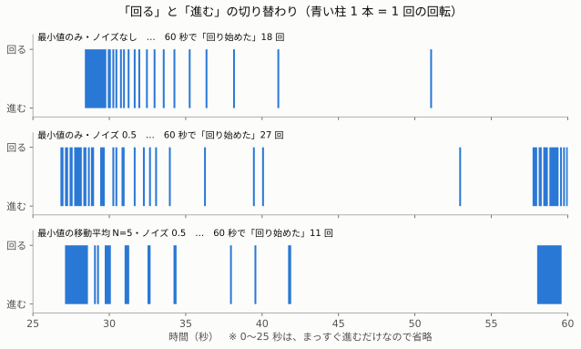

# 05. avoider ― 障害物をよける「頭」（フェーズ 2）

> **この章でわかること**
>
> - `avoider` のルール（前が近ければ回る、あいていれば進む）
> - なぜ「前方 61 本」の「いちばん小さい値」を使うのか
> - 実際に走らせたら、どう動いたか。どんな弱点が見つかったか

`avoider` は、`/scan`（目）を読んで、`/cmd_vel`（足）に指示を出す**頭**です。**あなたが書きました。**
コードは [avoider.py](../../src/room_robot_pkg/room_robot_pkg/avoider.py) です（この章はフェーズ 2 の形。フェーズ 3 で足した部分は [06](06-noise-and-filter.md)）。

## 1. ルールは 1 つだけ

**前に、1.5 m より近い物があれば、その場で回る。なければ、進む。**

| 前のようす | すること | `linear.x` | `angular.z` |
|---|---|---|---|
| 1.5 m より近い物がある | その場で、左に回る | 0.0 | 0.5 |
| 何もない（1.5 m 以上あいている） | 前に進む | 0.3 | 0.0 |

これを、`/scan` が届くたび（1 秒に 10 回）に、くり返します。

### 何度回るかは、決めていない

「90° 回る」のような決まりは、ありません。**毎回、前を見直して、あいていたら進む**だけです。

| 時間 | 前のいちばん近い物 | すること |
|---|---|---|
| 0.0 秒 | 1.48 m（壁が近い） | 回る（0.1 秒で約 3°） |
| 0.1 秒 | 1.48 m | 回る |
| … | … | 回るたびに、壁が「前」から外れていく |
| 1.4 秒 | 1.5 m 以上 | **進む**（ここまでで約 37° 回った） |

回ると、「前」も一緒に回ります。だから、壁がだんだん「前」から外れて、**自然に、回るのをやめます**。

## 2. 「前」とは、どこか：前方 61 本

正面から、左に 30°、右に 30° の範囲を「前」とします。


| 部分 | 番号 | 本数 |
|---|---|---|
| 正面と、左へ 30° まで | 0, 1, 2, …, 30 | 31 本 |
| 右へ 30° まで | 330, 331, …, 359 | 30 本 |
| 合計 | | **61 本** |

円は、359 の次が 0 にもどります。そのため、「前」は、`ranges` の**はじめ**（0〜30）と**おわり**（330〜359）の、2 か所に分かれます。

### 2.1 なぜ「前」だけを見るのか

| 理由 | 説明 |
|---|---|
| ① 前に進むなら、ぶつかる相手は前にいる | 横や後ろの物には、前に進んでも、ぶつからない |
| ② 全部を見ると、回り続けて動けなくなる | その場で回っても、**まわりの壁までの距離は変わらない**。「近い → 回る」が、ずっと続く |
| ③ ロボットの幅に、必要な角度がある | 下の図 |



ロボットの幅は 0.6 m です。1.5 m 先で、その幅が通る所を見るには、**左右に約 11° ずつ**あれば足ります。
それに**余裕を足して、±30°** にしました。30° は、決まった正解ではなく、「これくらいなら安全」と選んだ数です。

## 3. なぜ「いちばん小さい値（最小値）」を使うのか

**いちばん近い物が、いちばん危ない**からです。

たとえば、前方のレーザーのうち 5 本が、次の距離だったとします。

| ① | ② | ③ | ④ | ⑤ |
|---|---|---|---|---|
| 4.0 | 3.2 | 1.8 | 2.5 | **1.4** |

いちばん小さいのは **1.4（⑤）**です。1.5 より小さいので、**回ります**。
⑤ の 1 本だけでも近ければ、その方向に何かがある、ということです。

| 前方 61 本の最小値 | 意味 | すること |
|---|---|---|
| 1.5 m 以上 | どのレーザーも、1.5 m より遠い → 安全 | 進む |
| 1.5 m より小さい | 1 本でも近い → 何かある | 回る |

Python の `min(...)` は、たくさんの数の中から、いちばん小さい数を返します。**0 番から 1 本ずつ調べるプログラムを、自分で書く必要はありません。**

```python
min([4.0, 3.2, 1.8, 2.5, 1.4])    # → 1.4
```

## 4. コード

```python
class Avoider(Node):
    def __init__(self):
        super().__init__('avoider')
        self.pub = self.create_publisher(Twist, 'cmd_vel', 10)            # ① 足への口
        self.create_subscription(LaserScan, 'scan', self.on_scan, 10)     # ② 目からの口

    def on_scan(self, msg):                                # ③ /scan が届くたびに、ここが動く
        front = msg.ranges[0:31] + msg.ranges[330:360]     # ④ 前方 61 本
        nearest = min(front)                               # ⑤ いちばん近い距離
        out = Twist()                                      # ⑥ 指示の入れ物（最初は全部 0.0）
        if nearest < 1.5:
            out.linear.x = 0.0                             # ⑦ 回る
            out.angular.z = 0.5
        else:
            out.linear.x = 0.3                             # ⑧ 進む
            out.angular.z = 0.0
        self.pub.publish(out)                              # ⑨ 送る
```

| 番号 | 役割 | 入門編の `brain.py` でいうと |
|---|---|---|
| ①② | 送る口と、受け取る口を作る | 同じ（型が `Twist` と `LaserScan` に変わっただけ） |
| ③ | データが届いたら呼ばれる関数 | `on_distance` |
| ④⑤ | 前方 61 本の、最小値を出す | `msg.data`（数字 1 つ）を読む所 |
| ⑥〜⑧ | 回るか、進むかを決めて、速さを入れる | `cmd = 'TURN'` などを決める所 |
| ⑨ | 送る | `self.pub.publish(out)` |

### 4.1 配列の一部を取り出す（スライス）

`a[始め:終わり]` で、配列の一部を取り出せます。**「終わり」の番号は、入りません。**

```python
a = [10, 11, 12, 13, 14, 15, 16, 17, 18, 19]
#    0   1   2   3   4   5   6   7   8   9    ← 番号

a[0:3]          # → [10, 11, 12]    3 番（13）は入らない
a[7:10]         # → [17, 18, 19]
a[0:3] + a[7:10]   # → [10, 11, 12, 17, 18, 19]   + でつなげる
```

| 書きかた | 取れる番号 | |
|---|---|---|
| `ranges[0:30]` | 0〜**29** | ✗ 30 番が入らない |
| `ranges[0:31]` | 0〜30 | ✅ |
| `ranges[330:359]` | 330〜**358** | ✗ 359 番が入らない |
| `ranges[330:360]` | 330〜359 | ✅ |

### 4.2 Ctrl+C で止めるとき

```python
def main():
    rclpy.init()
    node = Avoider()
    try:
        rclpy.spin(node)                                    # データを待ち続ける
    except (KeyboardInterrupt, ExternalShutdownException):  # Ctrl+C の知らせ（2 種類ある）
        pass
    except Exception:
        if rclpy.ok():                                      # まだ動いているはずなのに出たエラーは、
            raise                                           # 本物のエラーなので、そのまま出す
    node.destroy_node()
    rclpy.try_shutdown()                                    # 「まだ終わっていなければ」終わらせる
```

Ctrl+C を押すと、ROS 2 は、自分で後片づけを始めます。そのタイミングによっては、「もう終わっています」というエラーが出ることがあります（試験では 25 回に 2 回）。
そこで、**後片づけ中に出たエラーだけ**を、無視しています。

## 5. 動かしかた

`setup.py` の `console_scripts` に 1 行足して、ビルドします（最初の 1 回だけ）。

```python
'avoider = room_robot_pkg.avoider:main',
```

```bash
cd /root/ros2_ws
colcon build --symlink-install --packages-select room_robot_pkg
source install/setup.bash
```

```bash
# タブ 1
ros2 run room_robot_pkg room_sim
# タブ 2
ros2 run room_robot_pkg avoider
```

> `avoider` は、画面に何も表示しません。動きは、**ブラウザの図**と、**タブ 1 の「回り始めた」のログ**で見ます。

## 6. 実験：どこで回り始めるか

**問題**：スタートから右へ進むと、`x` がいくつのときに、最初に回り始めるか。

**考えかた**：正面の壁（x = 20）までの距離は「20 − x」です。これが 1.5 より小さくなったら回ります。

```
20 − x ＜ 1.5   →   x ＞ 18.5
```

| | 計算 | 結果（`room_sim` のログ） |
|---|---|---|
| 最初に回り始めた x | 18.5 より少し先 | **18.52** |
| 最初に回った角度 | 30° より少し多く | **3° → 40°**（約 1.4 秒） |

**なぜ 18.52**：1 歩で 0.03 m 進みます（0.3 × 0.1）。18.49 の次が 18.52 で、そこで初めて 20 − 18.52 ＝ 1.48 ＜ 1.5 になりました。

**なぜ約 40°**：「前」は ±30° なので、壁の真正面が「前」から外れるまで、少なくとも 30° 回る必要があります。

### 走った道すじ



| 見えること | 内容 |
|---|---|
| 動き | 右の壁で回って、**壁にそって上へ** → 上の壁にそって**左へ** → … と、壁ぞいに走り続ける |
| 壁との距離 | 中心から約 0.8〜0.9 m。ロボットの半径 0.3 m を引いても、約 0.5 m あいている。ぶつからない |
| 止まらないか | 300 秒の計算で、一度も押し当たらなかった（いちばん近づいたのは 0.77 m） |

## 7. 見つかった弱点

### 弱点 ①：回る・進むが、細かく入れかわる（チャタリング）

最初の回転のあと、「回り始めた」「回るのをやめた」が、何度も交互に出ました。下の図の、いちばん上の段です。



| 段 | 60 秒で「回り始めた」回数（この 1 回の走行） |
|---|---|
| 最小値のみ・ノイズなし（この章の `avoider`） | 18 回 |

```
進む（1 歩）→ 最小値が 1.5 を少し下回る → 回る（1 歩、約 3°）
  → 1.5 を少し上回る → 進む（1 歩）→ …… くり返し
```

境目（1.5 m）の**ちょうど上**で、判断が行ったり来たりしています。入門編で学んだ**チャタリング**と同じです。
ノイズを足していないのに、もう起きています。直しかたは、入門編と同じ**ヒステリシス**（回り始める線と、やめる線をずらす）で、フェーズ 4 で書きます。

### 弱点 ②：壁ぞいばかり走る

部屋の真ん中や、障害物の近くには、ほとんど行きません。掃除ロボットとしては、物足りません。今回のルールの限界です。

## まとめ

| 覚えること | 内容 |
|---|---|
| ルール | 前方の最小値が 1.5 m より小さければ回る。そうでなければ進む |
| 前方 | `ranges[0:31]` ＋ `ranges[330:360]` の 61 本 |
| 最小値 | いちばん近い物が、いちばん危ない。`min(...)` で求める |
| 回る量 | 決めない。前があいたら、自然にやめる |
| 弱点 | 境目の上で、回る・進むが細かく入れかわる（チャタリング） |

## 用語集

| 用語 | 意味 |
|---|---|
| 最小値 | いくつかの数の中で、いちばん小さい数 |
| スライス | 配列の一部を、`a[始め:終わり]` で取り出すこと。終わりは入らない |
| コールバック | データが届いたときに、自動で呼ばれる関数（ここでは `on_scan`） |
| チャタリング | 境目の上で、判断が行ったり来たりすること |

次は [06. ノイズと、最小値・平均・移動平均](06-noise-and-filter.md) へ。
