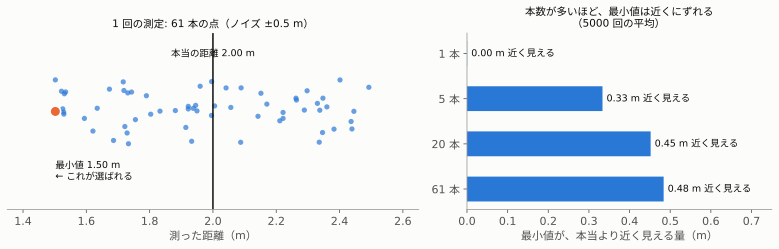
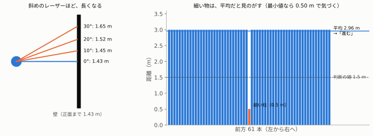
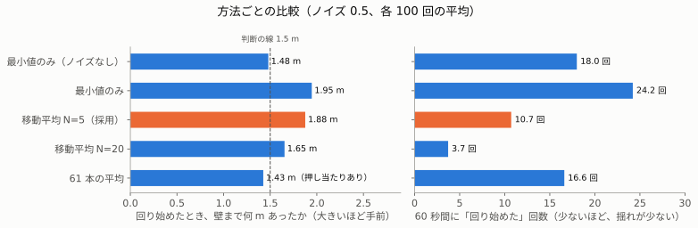

# 06. ノイズに強くする ― 最小値・平均・移動平均（フェーズ 3）

> **この章でわかること**
>
> - 測った距離が「ぶれる」と、`avoider` の判断がどう変わるか
> - 「最小値」「平均」「移動平均」の、それぞれの良い所と弱い所
> - なぜ「最小値の移動平均（過去 5 回）」を選んだのか

入門編の [03. ノイズ・チャタリング・フィルタ](../basics/03-noise-and-filters.md) の考えは、360 本のレーザーでも通じるのか。予想 → 実測で確かめます。

## 1. ノイズとは

本物のセンサーは、同じ物を測っても、**測るたびに、少しずつちがう値**を返します。これを**ノイズ**と呼びます。

`room_sim` では、パラメータ `noise` で、ノイズの大きさを決めます。

```bash
ros2 run room_robot_pkg room_sim --ros-args -p noise:=0.5    # 起動のときに決める
```

| `noise` | 本当は 10.0 m のレーザーが、測るたびに… |
|---|---|
| 0.0 | 10.0、10.0、10.0 |
| **0.5** | 9.553、9.553、9.895（実測）。**9.5〜10.5 の間で、ばらばらにぶれる** |

ぶれは、**レーザー 1 本ずつ、別々**です。61 本あれば、大きくぶれる物も、小さくぶれる物もあります。

---

## 2. 最小値は、ノイズで「近い側」にずれる

### 予想問題

ノイズ 0.5 で `avoider`（最小値のみ）を動かします。回り始める位置は、ノイズなし（x = 18.52）とくらべて、どうなるか。

| | あなたの予想 | 結果 |
|---|---|---|
| 答え | **C：もっと手前で回る** | **x = 18.05**（100 回の計算の平均。全部 18.01〜18.10 の間）✅ |
| 実機のノードで 3 回 | | 18.04、18.07、18.04 ✅ |

100 回やって、**100 回とも手前**でした（別に 200 回ためしても、全部手前でした）。たまたまではなく、**必ず手前**になります。

### なぜ、手前になるのか

**61 人が、ものさしで、壁までの距離を測る**ところを想像してください。みんな、±0.5 m くらい、測りまちがえます。
この中から、**「いちばん短く測った人」の値だけ**を使ったら、どうなるでしょう。



左の図は、本当は 2.00 m の壁を、61 本で 1 回測った例です。

| | 値 |
|---|---|
| 本当の距離 | 2.00 m |
| 61 本の平均 | 1.98 m（ほぼ本当の値） |
| 61 本のうち、いちばん小さい値（最小値） | **1.50 m**（0.5 m も近い） |

61 本もあれば、**1 本くらいは、ほぼ −0.5 m 近く測ってしまう物**があります。最小値は、わざわざ**その 1 本を選んでしまう**のです。

右の図は、本数を変えて、5000 回ずつためした結果です。

| 本数 | 最小値が、本当より近く見える量（平均） |
|---|---|
| 1 本 | 0.00 m（ずれない） |
| 5 本 | 0.33 m |
| 20 本 | 0.45 m |
| **61 本** | **0.48 m** |

**本数が多いほど、「運悪く近くに出た 1 本」に当たりやすく**なります。61 本では、約 0.48 m 近く見えます。

```
avoider は「最小値 ＜ 1.5」で回る
最小値は、本当より約 0.48 m 小さく出る
→ 本当の距離が 1.5 ＋ 0.48 ＝ 約 1.98 m のときに、もう回り始める
→ x ＝ 20 − 1.98 ≒ 18.02（実測 18.05）
```

**「1.5 m でよける」つもりが、「約 2 m でよける」ロボットになりました。**

| 良い所 | 弱い所 |
|---|---|
| 早めによけるので、安全寄り | 必要以上に、手前で回る。せまい所を、通れなくなる |

---

## 3. 平均は、ずれないが、危ない

### 予想問題

`nearest = min(front)` を、61 本の**平均**（全部足して 61 で割る）に変えると、どうなるか。安全か。

| | あなたの予想 | 結果 |
|---|---|---|
| 回り始める位置 | **C：もっと壁に近づいてから** | **x = 18.57**（100 回の計算）✅ |
| 安全か | **安全じゃない** | 60 秒の走行で、**押し当たりが起きた** ✅ |

平均なら、+ のぶれと − のぶれが、打ち消し合います。だから、最小値のような「近い側へのずれ」は、ありません。それなのに、危ない理由が 2 つあります。



### 理由 ①：ななめのレーザーは、長い

左の図のように、壁に向かっていても、**ななめのレーザーほど、壁まで長く**なります。

| 角度 | 壁まで（正面 1.43 m のとき） | 正面の何倍 |
|---|---|---|
| 0° | 1.43 m | 1.00 倍 |
| 10° | 1.45 m | 1.02 倍 |
| 20° | 1.52 m | 1.06 倍 |
| 30° | 1.65 m | 1.15 倍 |

61 本を平均すると、**正面の約 1.05 倍**の長さに見えます。だから、壁に**より近づいてから**、やっと 1.5 を下回ります。

```
平均 ＝ 正面の距離 × 1.05 が、1.5 より小さくなるとき
→ 正面の距離が 1.5 ÷ 1.05 ≒ 1.43 m のとき
→ x ＝ 20 − 1.43 ≒ 18.57（実測 18.57）
```

### 理由 ②：細い物を、見のがす

右の図は、前方に**細い柱**が 1 本だけあるときの例です。61 本のうち 1 本だけが 0.5 m、残りの 60 本は 3.0 m です。

| 使う値 | 計算 | 判断 |
|---|---|---|
| 最小値 | 0.50 m | 1.5 より小さい → **回る（正しい）** |
| 平均 | (0.5 ＋ 3.0 × 60) ÷ 61 ≒ **2.96 m** | 1.5 より大きい → **進む（ぶつかる！）** |

平均は、「全体のようす」を見る方法です。「いちばん近い 1 本」の危なさを、うすめてしまいます。椅子の脚や、テーブルの脚のような物を、見のがします。

---

## 4. 移動平均は、「ぶれ」だけを減らす

### 2 種類の「平均」

ここまでの「平均」は、**同じ時刻の 61 本**を平均しました（危なかった）。
入門編で使った**移動平均**は、**同じ物を、時間をずらして何回か測った値**を平均します。

| | 何を平均するか | 結果 |
|---|---|---|
| 61 本の平均 | **いま**の 61 本 | 細い物を見のがす（危ない） |
| **最小値の移動平均** | **過去 5 回ぶん**の最小値 | 最小値の「安全寄り」を残したまま、ぶれを減らす |

**例：過去 5 回の最小値が、こうだったとき**

| 回 | 1 回目 | 2 回目 | 3 回目 | 4 回目 | 5 回目（いま） |
|---|---|---|---|---|---|
| 最小値 | 1.62 | 1.55 | 1.49 | 1.58 | 1.51 |

```
移動平均 ＝ (1.62 ＋ 1.55 ＋ 1.49 ＋ 1.58 ＋ 1.51) ÷ 5 ＝ 7.75 ÷ 5 ＝ 1.55
```

最小値だけを見ていると、3 回目（1.49）で「回る」、4 回目（1.58）で「進む」と、行ったり来たりします。
移動平均（1.55）なら、ずっと「進む」のままで、ぶれません。

### 予想問題

最小値を、過去 5 回で移動平均すると、回り始める位置は、最小値のみ（x = 18.05）から、どうなるか。

| | あなたの予想 | 結果 |
|---|---|---|
| 答え | C：もっと壁に近づく（18.57 より先） | **x = 18.12**（ほぼ同じ）✗ |
| 理由 | 「過去の値も平均されるので」 | **しくみは正しい。でも、ずれる量が小さかった** |

あなたの考え（過去の値がまざるので、少し遅れる）は、**合っていました**。近づいている間、過去の最小値は、いまより少し遠いからです。
でも、その遅れは**約 2 歩ぶん（0.03 × 2 ≒ 0.06 m）だけ**でした。実測でも 18.12 − 18.05 ＝ 0.07 m です。

> 予想の選択肢に、「18.57 より先」のような**大げさな数**を書いたのは、問題を作った私のミスです。ずれの「向き」は、あなたの予想どおりでした。

### かたよりと、ぶれ

ノイズの影響には、2 種類あります。

| 種類 | どんなもの | 移動平均で |
|---|---|---|
| **ぶれ** | 毎回、ばらばらに上下する | **減る** |
| **かたより** | 毎回、同じ向きにずれる（最小値の −0.48 m） | **減らない** |

最小値の「近い側へのずれ」は、**毎回同じ向き**なので、何回平均しても残ります。だから、18.05 → 18.12 と、ほとんど変わりませんでした（18.52 にはもどりません）。

---

## 5. くらべてみる

ノイズ 0.5 で、それぞれ 100 回ずつ走らせて、平均しました。



| 方法 | 回り始めたときの壁までの距離 | 60 秒で「回り始めた」回数 | いちばん近づいた距離 |
|---|---|---|---|
| 最小値のみ（ノイズなし。くらべるため） | 1.48 m | 18.0 回 | 0.78 m |
| 最小値のみ | 1.95 m | **24.2 回** | 0.99 m |
| **最小値の移動平均 N=5（採用）** | **1.88 m** | **10.7 回** | 0.92 m |
| 最小値の移動平均 N=20 | 1.65 m | 3.7 回 | 0.89 m |
| 61 本の平均 | 1.43 m | 16.6 回 | **0.30 m（押し当たり）** |

N は、何回ぶんを平均するか、です。

| N | ぶれ（回数） | 遅れ（壁までの距離のちがい。N=1 とくらべて） |
|---|---|---|
| 1（平均しない） | 多い（24.2 回） | なし |
| **5** | **半分以下（10.7 回）** | **小さい（0.07 m）** |
| 20 | とても少ない（3.7 回） | 大きい（0.30 m） |

入門編の「N を大きくすると、ぶれは減るが、遅れる」と、同じです。**N = 5 くらいが、ちょうどよい**と判断しました。

### 時間で見ると


青い柱 1 本が、1 回の「回る」です。この図は、それぞれ **1 回ずつ**走らせた結果です（上の表は 100 回の平均なので、少しちがいます）。

| 段 | この 1 回の、60 秒の「回り始めた」回数 |
|---|---|
| 最小値のみ・ノイズなし | 18 回 |
| 最小値のみ・ノイズ 0.5 | 27 回（ノイズで、細かい柱が増えた） |
| 最小値の移動平均 N=5・ノイズ 0.5 | 11 回（柱が太く、少なくなった） |

> **訂正**：以前、「ノイズで、回り始める回数は増えない」と説明しました。40 秒で測ったときは 16 → 16.7 回で、差が小さかったためです。60 秒で測ると、18.0 → 24.2 回に**増えます**。

### 遅れは、「回るのをやめる」にも出る

あなたの実機のログでは、最初の回転が、こう変わりました。

| | 最初に回った角度 |
|---|---|
| 最小値のみ・ノイズなし | 3° → **40°** |
| 移動平均 N=5・ノイズ 0.5 | 3° → **49°**（約 9° 多く回った） |

前があいても、過去の「近い」値が、平均にしばらく残ります。そのため、**回るのをやめるのも、少し遅れて、回りすぎます**。
0.5 rad/秒（約 29°/秒）で 0.3 秒多く回ると、約 9° です。

---

## 6. コード（フェーズ 3 で足した所）

入門編の `brain.py` と同じ道具、**`deque`**（デック）を使います。決まった個数だけ覚えて、新しい物を入れると、いちばん古い物を捨てる入れ物です。

```python
from collections import deque
...
    def __init__(self):
        super().__init__('avoider')
        self.history = deque(maxlen=5)                       # ① 最小値を 5 個まで覚える
        ...

    def on_scan(self, msg):
        front = msg.ranges[0:31] + msg.ranges[330:360]
        nearest = min(front)                                 # ② いまの最小値
        self.history.append(nearest)                         # ③ 覚える（6 個目で、いちばん古いのを捨てる）
        dist = sum(self.history) / len(self.history)         # ④ 覚えている分の平均
        out = Twist()
        if dist < 1.5:                                       # ⑤ 判断には、平均を使う
            ...
```

| 番号 | ポイント |
|---|---|
| ② | 覚えるのは、**いまの最小値**（61 本の全部ではない） |
| ④ | 最初の 4 回は、まだ 5 個たまっていない。だから「5」ではなく、`len(...)`（いま覚えている個数）で割る |

## 7. 実機で確かめた結果

ノイズ 0.5、`avoider` は移動平均 N=5。

| 測ったもの | あなたの実機 | 私のテスト（3 回） | 計算（100 回の平均） |
|---|---|---|---|
| 最初に回り始めた x | **18.13** | 18.13、18.13、18.13 | 18.12 |
| 60 秒の「回り始めた」回数 | **8 回** | 10、10、10 回 | 10.7 回 |

ノイズなし・最小値のみの 18 回とくらべて、**半分以下**になりました。

## 8. まだ残っていること

ぶれは減りましたが、ゼロではありません（60 秒に 8〜10 回）。境目（1.5 m）の**ちょうど上**で、判断が行ったり来たりするからです。
入門編と同じ**ヒステリシス**（回り始める線と、やめる線をずらす）で、さらに減らせます。フェーズ 4 で書きます。

## 9. 数字を、自分で確かめる

この章の表と図の数字は、次のスクリプトで出せます（Mac で動きます。ROS 2 は不要）。

```bash
python3 tools/simulate_avoider_filters.py                   # 表の数字（約 3 分）
python3 tools/make_room_robot_figures.py                    # この文書の図（約 3〜4 分）
python3 tools/simulate_avoider_filters.py --trials 20 --seconds 40    # 軽くためす
```

どちらも、`room_sim` と同じ計算（[room_sim.py](../../src/room_robot_pkg/room_robot_pkg/room_sim.py)）を、そのまま使っています。

## まとめ

| 方法 | ずれ（かたより） | ぶれ | 安全 | 判定 |
|---|---|---|---|---|
| 最小値のみ | 近い側に約 0.48 m | 多い | 安全寄り | △ |
| 61 本の平均 | なし | ― | **危ない**（細い物を見のがす） | ✗ |
| **最小値の移動平均（N=5）** | 近い側に約 0.48 m のまま | **少ない** | 安全寄り | **◯（採用）** |

| 覚えること | 内容 |
|---|---|
| 最小値 | 本数が多いと、ノイズで近い側にずれる。でも、細い物を見のがさない |
| 平均（同じ時刻） | ずれないが、細い物を見のがす |
| 移動平均（時間） | **ぶれ**は減る。**かたより**は減らない。N が大きいほど遅れる |

## 用語集

| 用語 | 意味 |
|---|---|
| ノイズ | 測るたびに、値がばらばらにぶれること |
| ぶれ | 毎回、ばらばらに上下すること。平均すると減る |
| かたより | 毎回、同じ向きにずれること。平均しても減らない |
| 移動平均 | 過去 N 回ぶんを平均すること。N が大きいほど、ぶれは減るが、遅れる |
| `deque(maxlen=N)` | N 個まで覚える入れ物。N＋1 個目を入れると、いちばん古い物が消える |
