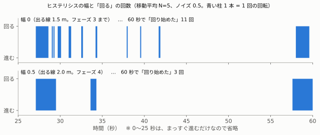
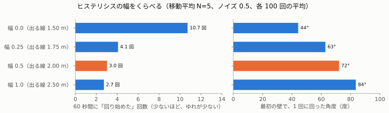
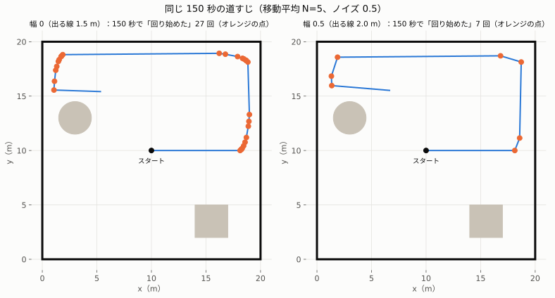

# 07. ヒステリシスで、ちょこちょこ回りを止める（フェーズ 4）

> **この章でわかること**
>
> - 「回り始める線」と「回るのをやめる線」を分けると、何が変わるか
> - 「いま、よけている最中か」を覚える変数の書きかた
> - 幅（2 本の線の差）を、どう決めたか。入門編とのちがい

## 1. いまの問題

フェーズ 3 までの `avoider` は、**同じ 1 本の線（1.5 m）**で、回り始めも、回るのをやめるのも決めていました。

| 判断に使う値（過去 5 回の最小値の平均） | すること |
|---|---|
| 1.5 m より小さい | 回る |
| 1.5 m 以上 | 進む |

そのため、壁ぞいで「回る → 少し進む → また 1.5 m を切る → 回る → …」が、細かく続いていました。
ノイズ 0.5 のとき、**60 秒に約 11 回**です（[06](06-noise-and-filter.md)）。下の図の上の段です。



## 2. 直しかた：線を 2 本にする

入門編の `brain` の STOP と同じ考えです（[入門編 03 の 4 章](../basics/03-noise-and-filters.md#4-対策-2ヒステリシス)）。

| 線 | 値 | 使うとき |
|---|---|---|
| **入る線**（回り始める） | 1.5 m | いま、進んでいるとき |
| **出る線**（回るのをやめる） | 1.5 ＋ 幅。幅 0.5 なら **2.0 m** | いま、回っているとき |

```
進んでいる → 前が 1.5 m より近くなったら、回り始める
回っている → 前が 2.0 m 以上あくまで、回り続ける
             （1.5〜2.0 m の間では、回るのをやめない）
```

## 3. コード

あなたが書いたコードです。

```python
    def __init__(self):
        super().__init__('avoider')
        self.avoiding = False                      # ① いま、回ってよけている最中か
        self.declare_parameter('hysteresis', 0.5)  # ② 幅（m）
        ...

    def on_scan(self, msg):
        ...
        dist = sum(self.history) / len(self.history)
        hysteresis = self.get_parameter('hysteresis').value       # ③ 毎回読む
        threshold = 1.5 + hysteresis if self.avoiding else 1.5     # ④ どちらの線を使うか
        out = Twist()
        if dist < threshold:
            self.avoiding = True                                   # ⑤ 回る → 覚える
            ...
        else:
            self.avoiding = False                                  # ⑥ 進む → 覚える
            ...
```

| 番号 | ポイント |
|---|---|
| ① | `__init__` で 1 回だけ作る。`on_scan` で作ると、データが来るたびに `False` にもどり、覚えられない |
| ② ③ | 幅をパラメータにして、毎回読む。動かしたまま `ros2 param set /avoider hysteresis 1.0` で変えられる |
| ④ | 回っている最中なら 2.0 m、そうでなければ 1.5 m と比べる |
| ⑤ ⑥ | 決めた結果を覚えて、次のデータのときに使う |

入門編の `brain.py` の `self.slowing` と、まったく同じ形です。

## 4. 予想と結果

**問題**：出る線を 2.0 m（幅 0.5）にすると、60 秒の「回り始めた」回数は、どうなるか。

| | あなたの予想 | 結果 |
|---|---|---|
| 答え | **B：減る** | **約 11 回 → 3 回** ✅ |
| 理由 | 「壁から離れるので」 | 半分正解。いちばん大きく変わったのは、**1 回に回る角度** |

### 計算（100 回ずつの平均。移動平均 N=5、ノイズ 0.5、60 秒）



| 幅（出る線） | 「回り始めた」回数 | 最初の壁で、1 回に回った角度 | いちばん近づいた距離 |
|---|---|---|---|
| 0（1.5 m） | 10.7 回 | 44° | 0.92 m |
| 0.25（1.75 m） | 4.1 回 | 63° | 0.99 m |
| **0.5（2.0 m。採用）** | **3.0 回** | **72°** | 0.99 m |
| 1.0（2.5 m） | 2.7 回 | 84° | 1.03 m |

### 実機（`room_sim` と `avoider` を動かした結果）

| | 「回り始めた」回数 | 最初の回転 |
|---|---|---|
| 私のテスト（幅 0.5、60 秒、3 回） | 3 回、3 回、3 回 | 3° → 72°、72°、69° |
| 私のテスト（幅 0、60 秒、1 回） | 12 回 | 3° → 46° |
| あなたの実機（幅 0.5、約 72 秒） | 最初の 60 秒で 2 回（全体で 4 回） | 3° → **74°** |

### なぜ減ったのか：まとめて 1 回で、大きく回る

| | 幅 0 | 幅 0.5 |
|---|---|---|
| 回りかた | 約 44° 回って、すぐ進む。少し進むと、また 1.5 m を切って、約 3° ずつ何度も回る | 2.0 m あくまで回り続けるので、**一度に約 72° 回る** |
| そのあと | 壁と、ほぼ平行のまま、すれすれを進む | 壁から、はっきり外れる向きに進む |

あなたの実機のログでは、どちらの壁でも、**大きく約 70° 回る → 少し進む → もう 1 回だけ約 15° 回る**、という形でした。
幅 0 のときに十何回も続いていた小さな回転が、**1 回で済んで**います。

| 起動からの時間 | できごと | 回った角度 |
|---|---|---|
| 31.9 秒 | 右の壁で回り始める（x = 18.13） | 3° → 74°（71°） |
| 41.9 秒 | もう一度、少し回る | 77° → 92°（15°） |
| 62.4 秒 | 上の壁で回り始める | 95° → 163°（68°） |
| 71.8 秒 | もう一度、少し回る | 166° → 180°（14°） |

150 秒の道すじでくらべると、ちがいがよく分かります。



| | 150 秒で「回り始めた」回数（この 1 回の走り） |
|---|---|
| 幅 0 | 27 回（右の壁と、左上の角に、オレンジの点が集まる） |
| 幅 0.5 | 7 回（角ごとに、1〜2 回） |

## 5. 幅は、どう決めたか

入門編では、「**幅は、ノイズの全幅（1.0）以上**」と決めました。`avoider` では、**0.5 で十分**でした。理由は、**ゆれの原因が、入門編とちがう**からです。

| 判断に使う値 | 壁まで本当に 2.0 m のとき、99% の値が入る範囲 | ぶれの幅 |
|---|---|---|
| 1 本の測定値（ノイズ ±0.5） | 1.51〜2.50 m | 0.99 m |
| 61 本の最小値 | 1.50〜1.58 m | 0.08 m |
| **最小値の 5 回平均（`avoider`）** | **1.50〜1.54 m** | **0.04 m** |

`avoider` が判断に使う値は、**止まっていれば、ほとんどぶれません**（0.04 m）。最小値をとって、さらに平均しているからです。
では、なぜゆれていたのか。**ロボット自身が動くから**です。

```
回るのをやめる（前が 1.5 m をわずかに超えた）
  → 1 歩（0.03 m）進む → 前の端の壁が、また 1.5 m を切る → また回る
```

これは、ノイズがなくても起きます（[05 の弱点 ①](05-avoider.md#7-見つかった弱点)）。
だから、幅は「ノイズの全幅」ではなく、**計算でくらべて**決めました。0.25 で大きく減り、0.5 で 3 回、1.0 でも 2.7 回とほぼ同じです。
1.0 にすると、1 回に回る角度が大きくなる（84°）だけなので、**0.5** にしました。

> **覚えること**：ヒステリシスの幅は、「何がゆれを起こしているか」で決める。センサーのノイズなら、ノイズの全幅以上。動きが原因なら、実際に動かして、くらべて決める。

## 6. 数字を、自分で確かめる

```bash
python3 tools/simulate_avoider_filters.py --hysteresis          # 4 章の表（約 3 分）
python3 tools/make_room_robot_figures.py --only hysteresis-compare    # 4 章の図
```

`--trials 20` を付けると、短い時間でためせます。

## まとめ

| 覚えること | 内容 |
|---|---|
| 2 本の線 | 進んでいるときは 1.5 m で回り始め、回っているときは 2.0 m まで回り続ける |
| 状態を覚える | `self.avoiding` を `__init__` で作り、決めるたびに更新する |
| 効果 | 60 秒の「回り始めた」が、約 11 回 → 3 回。一度に大きく回るようになった |
| 幅の決めかた | ゆれの原因で決める。`avoider` のゆれは、ノイズではなく、ロボットの動きが原因 |

## 用語集

| 用語 | 意味 |
|---|---|
| ヒステリシス | 入る線と出る線を、わざとずらすしくみ |
| 入る線・出る線 | 状態に入るときと、出るときに使う、別々の線 |
| 状態変数 | 「いま、どの状態か」を覚えておく変数（`self.avoiding`） |
| 幅 | 入る線と出る線の差（`hysteresis`） |

次は [08. launch ファイル](08-launch.md)（フェーズ 5）へ。
